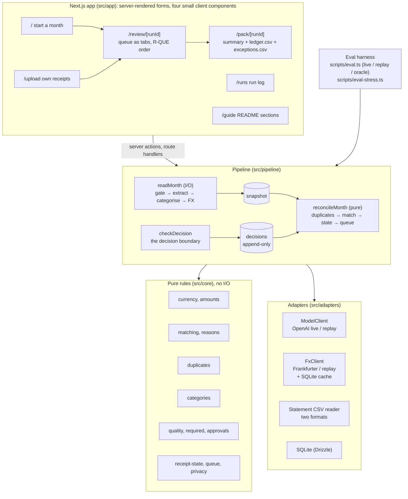

# Architecture

This system turns one month of staff receipts plus a card or bank statement export into a reconciled ledger, an exception-first review queue that a person works through, and a month-end pack (ledger CSV, exceptions log, readable summary). This document describes the system **as built at the end of the sprint** (`final`, Day 5). The design rationale and its history are in [`sprint/04-system-design.md`](sprint/04-system-design.md); every money rule is in [`sprint/05-business-rules.md`](sprint/05-business-rules.md); measured results are in [`EVALUATION.md`](EVALUATION.md).

## The one idea

**The model reads; code decides; a person approves.** A language model does perception only: reading a receipt image or PDF into fields, and suggesting a category when no keyword rule applies. Everything that touches money is deterministic, pure TypeScript in `src/core`: currency conversion, amount thresholds, matching, duplicates, statuses, approval rules, and queue order. Every rule has a named unit test, and a test fails the build if `src/core` ever performs I/O. Nothing is approved without a person, and every human decision is an audited row the month is re-derived from.

This split comes from the Accounting user's acceptance-test evidence: the errors that hurt were rules applied in the wrong place (AUD receipts sent through FX conversion; a payment status set by hand), not unreadable receipts. It is also the measured edge over a single chat prompt: on the same 20 receipts, the B1 ChatGPT baseline paired 3 of 19 payments wrongly in every run, and the system none. The two cold runs on Day 4 added a third lesson, built into the design below: the system's own matching was right every time, and every wrong number came from a person pairing a receipt with an unrelated payment, so the human step has guardrails too.

## Components



**Boundary rule, enforced.** `src/core` imports nothing from adapters, the pipeline, config, or the UI, and performs no I/O. [`src/core/boundary.test.ts`](../src/core/boundary.test.ts) fails `pnpm test` if a core file imports a Node built-in, an adapter, React, the database, reads `process.env`, or calls `fetch`. Policy thresholds reach the rules only as function arguments.

**Read once, reconcile on every view.** `readMonth` does the I/O (quality gate, model calls, FX fetch) once and stores a snapshot of what was read. `reconcileMonth` is pure: it derives every exception, match, status, queue position, and total from the snapshot **plus every human decision**, again on every page view. A correction therefore flows through FX, duplicates, and matching exactly as the pipeline would, without another model call, and a status can never be set by hand (non-negotiable 3).

## Data flow for one month

| Step | Decided by | What happens |
|---|---|---|
| 1. Statement | Rule | The CSV is read by column name in either supported format (one signed Amount column, or Debit and Credit). A title row above the header, ISO dates, and US-style month-first dates are recognised; a month-first reading is named on the review page. Every bad row is reported at once, by spreadsheet row number. |
| 2. Quality gate | Rule (R-QUA) | Size floor for camera photos only (long side ≥ 1000 px, short ≥ 700 px); PDFs and screenshots skip it. A failure states the measured size and the fix. |
| 3. Extract | **Model**, then rule check | One call per receipt: vendor, date, total, currency, tax, summary, `isReceipt`, and a confidence per field. A strict Zod schema checks the contract; on failure, one retry with the validation error; then `UNREADABLE` ("enter its details by hand"). A field under 0.8 confidence, or a missing currency, flags `LOW_CONFIDENCE_FIELD`: currency is never assumed to be AUD. Card numbers are masked on the output. |
| 4. Categorise | Rule first, **model** second | Keyword table from `config/categories.json` (vendor, then items). Only without a hit does the model choose, from a list that excludes "Other". Confidence below 0.7 flags `UNKNOWN_CATEGORY`. |
| 5. FX | Rule (R-CUR) | One Frankfurter range call per foreign currency for the month, cached in SQLite. AUD never enters conversion. A missing rate is flagged only when the AUD amount depends on it: a receipt matched to a line showing its original currency takes the bank's AUD charge. Never a rate of 1. |
| 6. Duplicates | Rule (R-DUP) | Same file hash, or same vendor + date + total + currency. Copies are flagged, kept, and excluded from totals. |
| 7. Match | Rule (R-MAT) | Each receipt is scored against each line: amount 50/30, date 25/15/5, vendor 20/10, account 5. Lines more than 7 days away (R-MAT-9) and credits such as refunds (R-MAT-8) are never candidates. Auto-match needs ≥ 75 **and** a 20-point lead; 40–74 is ambiguous and goes to a person with the candidates and plain-language reasons. Assignment is greedy across the month, so a line is never paid out twice. Foreign purchases compare on the bank's original foreign amount. |
| 8. State and queue | Rule (R-APR, R-QUE) | Status, payment status, ledger amount, and exceptions are derived. The queue orders items in the user's five groups, worst first, largest amount first, with a total per group. Statement lines with no receipt are listed, with a suggested category (R-CAT-6). |
| 9. Decisions | **Person**, checked by rule | Every action goes through `checkDecision` ([`src/pipeline/decisions.ts`](../src/pipeline/decisions.ts)) and becomes an append-only row; the latest of each kind wins, approved items are locked. |

## Human approval points and their guardrails

The system never approves anything itself. A person approves each receipt (bulk approve only for clean `matched` items); chooses a payment for ambiguous or unmatched items; signs off an over-threshold difference; corrects any field or category; pays one receipt from several lines (R-MAT-10); and resolves each statement line with no receipt (link, substitute or credit, or not an expense). The submitter cannot approve their own receipt: the button is shown disabled with the reason.

The two Day 4 cold runs showed this step can undo the rules: three pairings in C1 and one in P1 joined a receipt to someone else's payment and were signed off "Good" or "This is good". The decision boundary now has five guardrails, all deterministic and tested:

| Guardrail | Rule | What it does |
|---|---|---|
| Only real suggestions | R-MAT-2 | Only candidates scoring 40+ are offered as choices; weak lines are in the full list |
| Pairing check | R-MAT-6 | A pairing that does not fit lists why, side by side with the receipt: not suggested, a different business (judged on distinctive words), % off, days apart, another account |
| Clear-mismatch block | R-MAT-11 | Refuses a pairing that is not suggested, from another business, and more than 50% off, from any screen; all four observed wrong pairings are refused |
| Specific reasons | R-AMT-4 | Every reason needs 8+ characters and more than filler ("good", "ok", "this is good") |
| Category suggestion | R-CAT-6 | A substitute filed against the suggested category needs an explicit tick, and stays marked in the pack |

## Data contracts

All boundaries are Zod schemas: [`src/core/schemas.ts`](../src/core/schemas.ts) for the domain, plus the CSV rows, the model-facing output schemas ([`src/pipeline/prompts.ts`](../src/pipeline/prompts.ts)), the forms, recordings, and `.env` ([`src/config/env.ts`](../src/config/env.ts)).

| Contract | Key fields | Note |
|---|---|---|
| `ReceiptIntake` | id, monthKey, submitterId, paymentSource (`company_card`, `personal_card`, `bank`, `unknown`), businessPurpose?, uploadOrder, file {path, mime, width?, height?, sha256} | A missing purpose is an exception, not a parse error |
| `Extraction` | each field `{value \| null, confidence 0..1}`; `isReceipt` | Date `YYYY-MM-DD`, currency `[A-Z]{3}` enforced after the call |
| `StatementLine` | id, date, description, amountAud (debits positive, credits negative), originalAmount?, account | Read by column name from either format |
| `MatchOutcome` | status (`matched`, `unmatched`, `amount_differs`, `ambiguous`), statementLineId, extraLineIds? (a split), candidates (≤ 3, score and reasons), exceptions, reimbursement | Status is derived only |
| `Decision` | subjectId (receipt or line), actorId, action, before, after, reason, at | Append-only audit rows; 10 actions |
| `MonthSnapshot` | what was read per receipt, statement lines, FX rates | Decisions are stored separately |
| `run_log` row | runId, receiptId, stage, status, durationMs, modelId, tokens, errorCode | Never receipt text, names, card numbers, or raw model output |

Money is compared in integer cents, so "over 10%" and "above $0.01" are exact.

## Model and tool choices

| Concern | Choice | Trade-off accepted |
|---|---|---|
| Extraction | OpenAI Responses API, `gpt-5.6-sol`, structured output, reasoning effort `low`, `store: false` | One vision call handles PDFs, photos, and screenshots. Same model as two of the three B1 runs, so the comparison isolates the design. Self-reported confidence varies run to run near the 0.8 threshold (R18's currency: 0.99, then 0.77), which moves the human-touch count by about one. |
| Category fallback | Same model, only when no keyword rule hits | One access check; a minority of receipts (10 of 40 in the Day 2 count) |
| FX rates | Frankfurter (ECB reference rates), no key | Public, historical, free; no weekend rates, so R-CUR-2 looks back up to 7 days |
| Storage | SQLite file (`better-sqlite3` + Drizzle) | Zero setup and local; one reviewer does not need multi-user concurrency |
| UI | Next.js App Router, server actions; four small client components: the queue tabs, the pending-state button, the navigation, and the actor switcher (Lucide icons) | Works as plain forms; the client code keeps typed input when switching tabs and shows "Saving…" |

**Measured (`final`, Day 5, live, 40 receipts):** 91,425 input and 4,214 output tokens, at most USD 0.45 for the month (USD 0.0112 per receipt; price in `config/pricing.json`). Model time p50 2.0 s, p95 5.0 s per receipt.

## Fallbacks

| Failure | Behaviour |
|---|---|
| Model API error, timeout, 429, 5xx | The SDK retries twice with backoff; then `UNREADABLE` ("enter its details by hand") and the month carries on. The failure is recorded by its code, so replay reproduces it. |
| Model output fails the schema | One retry with the validation error appended; then as above |
| Model refuses or returns nothing | As above, with the reason code in the run log |
| FX API down | Cached rates are used. With none: flagged only where the AUD amount needs a rate, excluded and listed by currency |
| Statement CSV unreadable | A plain message naming the expected columns, or every bad row and field; a file mixing day-first and month-first dates is refused |
| Replay has no recording | Fails loudly with how to re-record; never a silent fallback |

## Privacy

- Data stays local: SQLite and a local file store. Only the receipt file goes to the model API, with `store: false`; category requests send only vendor and items.
- Card-number patterns are masked to the last four digits on model output ([`src/core/privacy.ts`](../src/core/privacy.ts)).
- The run log holds ids, stage names, durations, token counts, and fixed error codes only.
- The ledger CSV neutralises spreadsheet formulas: vendor names come from a model reading uploaded files.
- Secrets live only in `.env` (gitignored); `.env.example` is committed.

## Reproducibility: replay mode

Every model request has a key: the SHA-256 of the task, model, reasoning effort, prompt text and version, output JSON schema, and each file's hash. `pnpm eval -- --mode live` writes each response (or failure code) to `fixtures/recordings/model/<key>.json`; FX responses go to `fixtures/recordings/fx/`. Replay serves them with no key and no network. Any change to a prompt, schema, model, or file changes the key, so a stale recording fails loudly. All 40 October receipts and the 7 stress receipts that reach the model are recorded (S01 is stopped by the size check first), so `pnpm seed`, `pnpm dev`, `pnpm eval`, and `pnpm eval:stress` all work without an API key.

## Where things live

```
src/core/       schemas, money, currency, amounts, matching, reasons, duplicates, required,
                categories, quality, approvals, receipt-state, queue, privacy  (+ tests)
src/pipeline/   read-month (I/O), reconcile (pure), decisions (the decision boundary), run-month,
                pack, prompts, run-log, config, stages/{extract,categorise}, oracle, test-month
src/adapters/   model/{openai,replay,recordings,types}, fx/{frankfurter,cached,types},
                statement/{csv,read-statement}, db/{client,schema}
src/server/     months.ts (run, store, and read a month for the UI and `pnpm seed`)
src/config/     env (Zod), categories, people (simulated sign-in)
src/app/        /, /upload, /review/[runId] (queue-tabs, panels), /pack/[runId] (+ two CSVs),
                /runs, /guide, /files/[runId]/[receiptId], submit-button
config/         categories.json (chart + keyword rules), pricing.json (price, source, date)
scripts/        eval, eval-stress, eval-compare, seed, generate-dataset, generate-stress,
                score-baseline, eval/{system,score,answer-sheet}
fixtures/       dataset/ (October month, ground truth, splits, B0 kit), stress/, recordings/
```

## Known limits

The most important first. Full list with evidence in [`EVALUATION.md`](EVALUATION.md) and [`CASE_STUDY.md`](CASE_STUDY.md).

- **Synthetic data and proxy users.** Every number is on one synthetic month; the two people who closed it were the builder and a proxy, not the Accounting user.
- One month at a time; no multi-month view or carry-over of unmatched items.
- Two bank export layouts; a third needs a new column mapping (one entry in `STATEMENT_FORMATS`).
- Substitute categories can only be checked where the rule table or a same-business receipt knows the payment (4 of 9 October lines); the rest needs rule-table entries from the finance lead.
- The model's confidence near the 0.8 threshold varies run to run, so the human-touch count can move by about one between identical runs.
- Simulated sign-in only (a header switcher); no authentication or roles.
