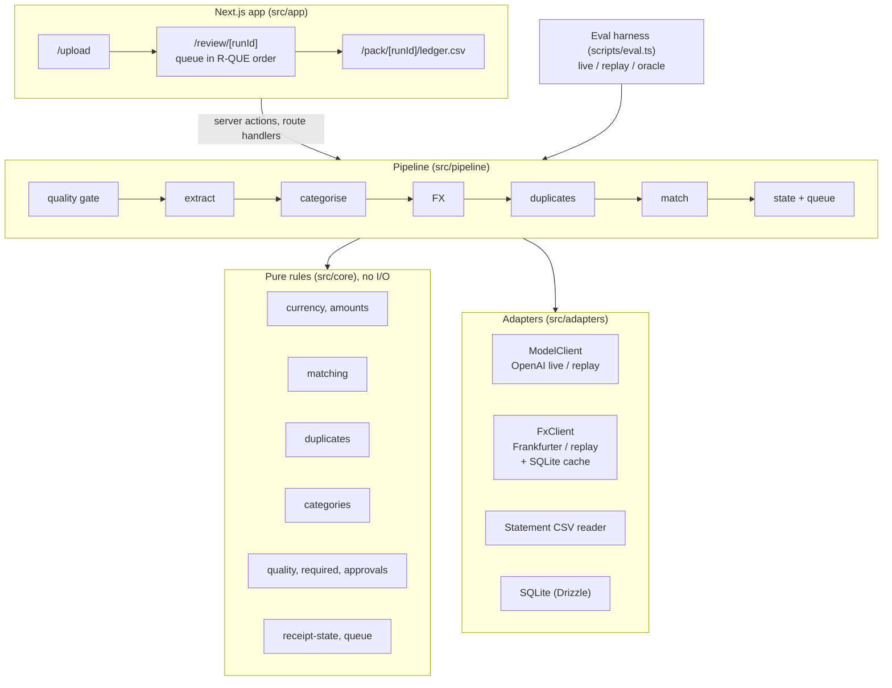

# Architecture

This system turns one month of staff receipts plus a card/bank statement export into a reconciled ledger, an exception-first review queue, and a month-end CSV. This document describes the system as built on Day 2 (v0). The design rationale and its history are in [`sprint/04-system-design.md`](sprint/04-system-design.md); the money rules are in [`sprint/05-business-rules.md`](sprint/05-business-rules.md).

## The one idea

**The model reads; code decides.** A language model does perception only: reading a receipt image or PDF into fields, and suggesting a category when no keyword rule applies. Everything that touches money is deterministic, pure TypeScript in `src/core`: currency conversion, amount thresholds, matching, duplicates, statuses, approval rules, and queue order. Every rule has a named unit test, and a test fails the build if `src/core` ever performs I/O.

This split comes from the Accounting user's acceptance-test evidence: the errors that hurt were rules applied in the wrong place (AUD receipts sent through FX conversion; a payment status set by hand), not unreadable receipts. It is also the system's measured edge over a single chat prompt: on the same 20 receipts, the B1 ChatGPT baseline paired 16% of payments wrongly in every run, and the system paired none wrongly (see [`EVALUATION.md`](EVALUATION.md)).

## Components



**Boundary rule, enforced.** `src/core` imports nothing from adapters, the pipeline, config, or the UI, and performs no I/O. [`src/core/boundary.test.ts`](../src/core/boundary.test.ts) fails `pnpm test` if a core file imports a Node built-in, an adapter, React, the database, reads `process.env`, or calls `fetch`. Policy thresholds therefore reach the rules only as function arguments.

## Data flow for one month

`runMonth` ([`src/pipeline/run-month.ts`](../src/pipeline/run-month.ts)) orchestrates. Each step names who decides.

| Step | Decided by | What happens |
|---|---|---|
| 1. Quality gate | Rule (R-QUA) | Orientation-aware size check for photos; PDFs and screenshots skip the blur check. A failure says what size was measured and how to fix it. |
| 2. Extract | **Model**, then rule check | One call per receipt returns vendor, date, total, currency, tax, summary, `isReceipt`, and a confidence per field. A strict Zod schema then checks the contract; on failure, one retry with the validation error appended; after that, `UNREADABLE` with "enter its details by hand". Card numbers are masked on the output. |
| 3. Categorise | Rule first, **model** second | Keyword table from `config/categories.json` (vendor name, then items). Only without a hit does the model choose, from an enum that excludes "Other". Confidence below 0.7 flags `UNKNOWN_CATEGORY`. |
| 4. FX | Rule (R-CUR) | One Frankfurter range call per foreign currency for the month. AUD never enters conversion. No rate within 7 days flags `FX_RATE_UNAVAILABLE` and excludes the amount, shown by currency; a rate is never defaulted to 1. |
| 5. Duplicates | Rule (R-DUP) | Same file hash, or same normalised vendor + date + total + currency. The earliest upload is the original; copies are flagged, kept, and excluded from totals. |
| 6. Match | Rule (R-MAT) | Each receipt is scored against each statement line (amount 50/30, date 25/15/5, vendor 20/10, account 5). Auto-match needs ≥ 75 **and** a 20-point lead over the runner-up; 40–74 is ambiguous and goes to a person with the top 3 candidates and plain-language reasons. Assignment is greedy across the month, so a line is never paid out twice. Foreign purchases compare on the bank's original foreign amount, so FX fees are never an "amount difference". |
| 7. State and queue | Rule (R-APR, R-QUE) | Status, payment status, ledger amount, and exceptions are derived from the stage results, never set directly. The queue orders items in the user's five groups, largest AUD first, with a total per group. Statement lines with no receipt are listed for a decision. |

## Data contracts

All boundaries are Zod schemas: [`src/core/schemas.ts`](../src/core/schemas.ts) for the domain, plus the CSV row schema, the model-facing output schemas ([`src/pipeline/prompts.ts`](../src/pipeline/prompts.ts)), the upload form, and `.env` ([`src/config/env.ts`](../src/config/env.ts)).

| Contract | Key fields | Note |
|---|---|---|
| `ReceiptIntake` | id, monthKey, submitterId, paymentSource (`company_card`, `personal_card`, `bank`, `unknown`), businessPurpose?, uploadOrder, file {path, mime, width?, height?, sha256} | A missing purpose is an exception, not a parse error |
| `Extraction` | each field `{value \| null, confidence 0..1}`; `isReceipt` | Date `YYYY-MM-DD`, currency `[A-Z]{3}` enforced after the call |
| `StatementLine` | id, date, description, amountAud (debits positive), originalAmount?, account | v0 reads one bank format; Day 3 adds column mapping |
| `MatchOutcome` | status (`matched`, `unmatched`, `amount_differs`, `ambiguous`), statementLineId, candidates (≤ 3, each with score and reasons), exceptions, reimbursement | Status is derived only |
| `ReceiptState` | exceptions (canonical order), status, paymentStatus, ledgerAmountAud, excludedFromTotals | Ledger amount is the AUD actually charged |
| `Decision` | subjectId (receipt or line), actorId, action, before, after, reason (≥ 3 chars), at | Immutable audit rows; used from Day 3 |
| `run_log` row | runId, receiptId, stage, status, durationMs, modelId, tokens, errorCode | Never receipt text, names, card numbers, or raw model output |

Money is compared in integer cents, so "over 10%" and "above $0.01" are exact.

## Model and tool choices

| Concern | Choice | Trade-off accepted |
|---|---|---|
| Extraction | OpenAI Responses API, `gpt-5.6-sol`, structured output, reasoning effort `low`, `store: false` | One vision call handles PDFs, photos, and screenshots, which a template or OCR pipeline would not. Same model as two of the three B1 runs, so the comparison isolates the design rather than the model. |
| Category fallback | Same model, only when no keyword rule hits | One access check; the call is rare (10 of 40 receipts in October; the other 30 hit a keyword rule). |
| FX rates | Frankfurter (ECB reference rates), no key | Public, historical, free. ECB has no weekend rates, so R-CUR-2 looks back to the last business day. |
| Storage | SQLite file (`better-sqlite3` + Drizzle), migrations applied on open | Zero setup and local; no multi-user concurrency, which a single Accounting user does not need. |
| UI | Next.js App Router, server actions | One app for the UI and API; a non-developer needs a web page, not a CLI. |

**Measured cost (v0-day2, 40 receipts, live):** 91,426 input and 4,188 output tokens, at most USD 0.45 for the month (USD 0.011 per receipt; pricing in `config/pricing.json`). Model latency p50 2.1 s, p95 4.6 s per receipt.

## Fallbacks

| Failure | Behaviour |
|---|---|
| Model API error, timeout, 429, 5xx | The SDK retries twice with backoff; then the receipt becomes `UNREADABLE` ("enter its details by hand") and the month carries on. |
| Model output fails the schema | One retry with the validation error appended; then as above. |
| Model refuses or returns nothing | As above, with the reason code in `run_log`. |
| FX API down | Rates already cached in SQLite are used; with none in range, `FX_RATE_UNAVAILABLE` (excluded, shown by currency). |
| Statement CSV in the wrong format | A plain message naming the expected columns, or the row and field that could not be read. |
| Replay has no recording for a request | Fails loudly with how to re-record. In the UI: "replay mode can only read receipts that were recorded in advance". Never a silent fallback. |

## Human approval points

The system never approves anything itself. A person: approves each receipt (bulk-approve only for `matched` items with no flags); chooses a match for ambiguous or unmatched items from the ranked candidates; signs off an over-threshold difference with a reason; corrects any field or category; and resolves statement lines with no receipt (link, substitute, or not an expense). The submitter cannot approve their own receipt: the control is shown disabled with the reason. The rules exist in `src/core/approvals.ts`; the review actions are Day 3 work.

## Privacy

- Data stays local: SQLite and a local file store. Only the receipt file goes to the model API, with `store: false`.
- Card-number patterns are masked to the last four digits on model output ([`src/core/privacy.ts`](../src/core/privacy.ts)).
- The run log holds ids, stage names, durations, token counts, and error codes only; a test checks that no vendor name appears in it.
- The ledger CSV neutralises spreadsheet formulas: vendor names come from a model reading uploaded files, so they are untrusted.
- Secrets live only in `.env` (gitignored); `.env.example` is committed.

## Reproducibility: replay mode

Every model request has a key: the SHA-256 of the task, model, reasoning effort, prompt text and version, output JSON schema, and each file's hash. `MODE=live RECORD=1` (or `pnpm eval -- --mode live`) writes each response to `fixtures/recordings/model/<key>.json`; FX responses go to `fixtures/recordings/fx/`. `MODE=replay` serves them with no key and no network. Any change to a prompt, schema, model, or file changes the key, so a stale recording fails loudly instead of answering for a different request. All 40 October receipts are recorded, so `pnpm seed`, `pnpm dev`, and `pnpm eval -- --mode replay` work without an API key.

## Where things live

```
src/core/       schemas, money, currency, amounts, matching, duplicates, required, categories,
                quality, approvals, receipt-state, queue, privacy  (+ a *.test.ts for each)
src/pipeline/   run-month.ts, stages/{extract,categorise}.ts, prompts.ts, run-log.ts, pack.ts,
                oracle.ts (ground-truth model for tests and `--mode oracle`)
src/adapters/   model/{openai,replay,recordings,types}.ts, fx/{frankfurter,cached,types}.ts,
                statement/{csv,format-a}.ts, db/{client,schema}.ts
src/server/     months.ts (run, store, and read a month for the UI and `pnpm seed`)
src/app/        /, /upload, /review/[runId], /pack/[runId]/ledger.csv
config/         categories.json (chart + keyword rules), pricing.json (per-token price, source, date)
scripts/        eval.ts, eval-compare.ts, seed.ts, generate-dataset.ts, score-baseline.ts
fixtures/       dataset/ (synthetic October month, ground truth, splits), recordings/
```

## Known limits at v0

- One statement format is read (format A); column mapping for other banks is Day 3.
- Review actions (approve, choose match, sign off, correct, resolve lines) are rules only; their UI is Day 3.
- Two scoring weaknesses found on Day 2 and queued for Day 4 failure analysis: a wordmark vendor name ("brightreachads") loses the vendor points, and the scoring table has no date gate, so a near-amount line two weeks away with a generic vendor word ("cafe") can reach the ambiguous band. Both fail safe (a missing point or an extra human touch), but they are real.
