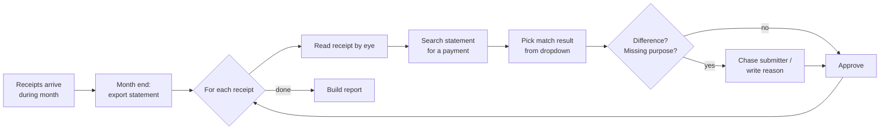
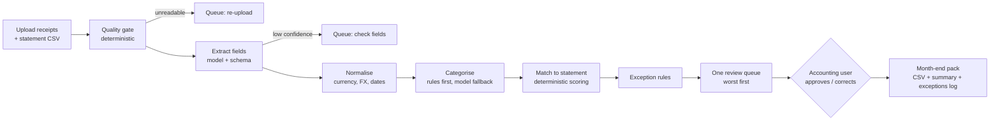

# 02. Workflow Map

Validate this map in the Day 1 interview. Where the interview disagrees, update this file and log the change in `TRACKER.md`. The interview wins over this draft.

## Current workflow (draft, from UAT evidence)

| Element | Today |
|---|---|
| **Trigger** | A receipt is submitted during the month. The real work happens at month end, when the statement is available and the report is due. |
| **Input** | Receipt images and PDFs (photos, screenshots, emailed PDFs, often USD for software), the submitter's business purpose (sometimes missing), and a card/bank statement export (CSV). |
| **Judgment** | Is the receipt readable? Which category is it? Which statement line paid for it? Is the amount difference acceptable? Does it need FX conversion? Is it a duplicate? Is the purpose a real business reason? |
| **Tool** | An internal finance tool with a manual match dropdown, the bank portal or a statement CSV, and a spreadsheet for checking. |
| **Approval** | A finance reviewer signs off each expense. An amount difference needs a written reason. No one approves their own expense. |
| **Output** | A reconciled ledger and a month-end report (CSV snapshot). |
| **Exceptions** | Missing or unreadable receipt, missing purpose, amount difference, foreign currency, duplicate, personal-card reimbursement, no matching payment, more than one plausible payment. |

## The bottleneck

**Pairing each receipt with its payment, and noticing exceptions, is done one item at a time by a person.** In the user's own words: "pick a request, hunt for the charge" (P1). Cost grows linearly with volume, and errors are silent: a missed difference or a wrong currency only shows up as a wrong total later (see P1, E1, and E2 in `01`).

Hypothesis to confirm on Day 1: most receipts are routine (one obvious payment, same amount, same currency), so most of the user's time goes to items that need no judgment. The system should clear those automatically and put human attention on the few that do need judgment.

## Target workflow (v1)

### Who decides what in v1

| Step | Decided by | Why |
|---|---|---|
| Is the file readable enough? | Rules | Measurable (dimensions, file type). E5 showed fuzzy checks cause rework. |
| What does the receipt say? | Model, then schema validation | Perception task. Fields carry confidence. Low confidence goes to a human. |
| Currency, FX, totals | Rules | E2 showed what happens when this is inferred. |
| Category | Rule table first; model only for unknown vendors | Must be explainable. The model's guess carries a reason and goes to the human if confidence is low. |
| Which payment matches? | Deterministic scoring | Auto-match only when there is a single clear winner. Otherwise a human chooses from ranked candidates. |
| Is the difference acceptable? | Policy threshold, then a human reason | Policy is the finance lead's. Sign-off is always human. |
| Final approval | Always a human | The system prepares. The human signs off. |
