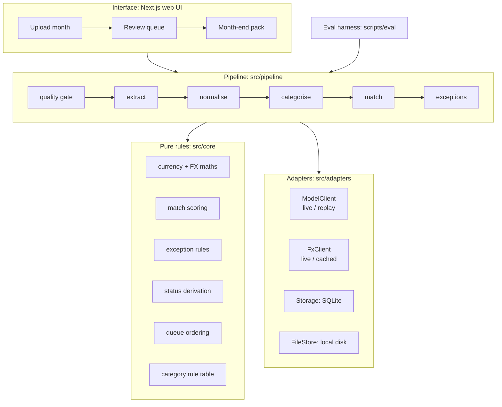

# 04. System Design

These are defaults with reasons. You may change one if you find a better option, but record the change and the reason in the decision log in `TRACKER.md`.

## Architecture



**Boundary rule:** `src/core` imports nothing from `src/adapters`, `src/pipeline`, or the UI. The pipeline orchestrates. The adapters do I/O. The UI calls the pipeline through route handlers or server actions.

## Technology choices

| Concern | Default | Rationale | Rejected alternative |
|---|---|---|---|
| Language | TypeScript (strict) | The candidate's strongest stack. Types are shared across UI, pipeline, and eval. | Python: better OCR ecosystem, but slower for the candidate to ship UI in |
| Interface | Next.js App Router, one app | A non-developer needs a web UI. Route handlers serve as the API. | CLI only: fails the non-developer UX criterion |
| Storage | SQLite file via `better-sqlite3` + Drizzle | Zero setup, reproducible, and the database file can be reset with `pnpm seed` | Postgres/Supabase: adds setup steps and a hosted dependency |
| Receipt extraction | Claude with vision (default `claude-sonnet-5-5`, set by `MODEL_EXTRACT`) | Handles photos, PDFs, and varied layouts in one call, and returns structured JSON | Tesseract + regex: brittle on varied layouts. Keep it as the fallback idea for the case study. |
| Category fallback | Claude (default `claude-haiku-5-5`, set by `MODEL_CATEGORISE`) | Cheap, short, text-only. Used only for vendors not in the rule table. | Model for every receipt: higher cost and less explainable |
| FX rates | Frankfurter public API (ECB reference rates, no key), cached in SQLite | A real, free, historical-rate integration. Check the current endpoint format on Day 2. | Hard-coded rates: not a real integration |
| Statement input | CSV upload with a column-mapping step | This is what banks export. The mapping handles different bank formats. | Bank API: a non-goal |
| Tests | Vitest (core and pipeline), Playwright (one critical UI flow) | Fast unit coverage of the money rules | n/a |

**Integrations that satisfy "at least two real data-source or tool integrations":** (1) the Claude API for vision extraction, (2) the FX rates API, and (3) bank statement CSV import with format mapping.

## Data contracts (Zod sketches; refine in `src/core/schemas.ts`)

```ts
const Money = z.object({ amount: z.number().finite(), currency: z.string().length(3) }); // amounts in major units; store cents as integers in DB

const ReceiptInput = z.object({
  id: z.string(),
  monthKey: z.string().regex(/^\d{4}-\d{2}$/),
  submitterId: z.string(),
  paymentSource: z.enum(["company_card", "personal_card", "bank", "unknown"]),
  businessPurpose: z.string().trim().max(500).optional(), // missing is an exception, not a parse error
  file: z.object({ path: z.string(), mime: z.enum(["image/jpeg", "image/png", "application/pdf"]), width: z.number().optional(), height: z.number().optional() }),
});

const ExtractedField = <T extends z.ZodTypeAny>(t: T) =>
  z.object({ value: t.nullable(), confidence: z.number().min(0).max(1) });

const Extraction = z.object({
  vendor: ExtractedField(z.string()),
  date: ExtractedField(z.string().regex(/^\d{4}-\d{2}-\d{2}$/)),
  total: ExtractedField(z.number()),
  currency: ExtractedField(z.string().length(3)),
  tax: ExtractedField(z.number()),
  summary: ExtractedField(z.string().max(200)),
  isReceipt: z.boolean(), // false => exception "not a receipt"
});

const StatementLine = z.object({
  id: z.string(), date: z.string(), description: z.string(),
  amountAud: z.number(), // debits positive
  originalAmount: Money.optional(), // when the bank shows a foreign amount
  account: z.enum(["company_card", "personal_card", "bank"]),
});

const MatchResult = z.object({
  receiptId: z.string(),
  status: z.enum(["matched", "unmatched", "amount_differs", "ambiguous"]), // derived only
  statementLineId: z.string().nullable(),
  candidates: z.array(z.object({ statementLineId: z.string(), score: z.number(), reasons: z.array(z.string()) })).max(3),
});

const ExceptionCode = z.enum([
  "AMOUNT_DIFFERS_OVER_THRESHOLD", "MISSING_PURPOSE", "DUPLICATE", "NO_PAYMENT_FOUND",
  "AMBIGUOUS_MATCH", "LOW_CONFIDENCE_FIELD", "UNREADABLE", "NOT_A_RECEIPT",
  "SELF_APPROVAL_BLOCKED", "FX_RATE_UNAVAILABLE", "UNKNOWN_CATEGORY",
]);

const Decision = z.object({ // every human action is one immutable row
  id: z.string(), receiptId: z.string(), actorId: z.string(),
  action: z.enum(["approve", "correct_field", "choose_match", "override_status", "request_reupload"]),
  before: z.unknown(), after: z.unknown(), reason: z.string().min(3).optional(), at: z.string(),
});
```

## Pipeline behaviour, fallbacks, and retries

| Stage | Failure | Behaviour |
|---|---|---|
| Quality gate | Too small or corrupt | Reject with a plain reason and the size that is needed. Queue item: re-upload. |
| Extract | Model or network error | Retry twice with backoff. Then the item goes to the queue as "Enter details manually" with an empty form. The pipeline continues with the other receipts. |
| Extract | Output fails schema validation | Retry once with the validation error appended to the request. Then fall back to manual entry. |
| Extract | Field confidence below 0.8 (configurable) | Keep the value and flag `LOW_CONFIDENCE_FIELD`. The UI highlights the field. |
| Normalise | FX API down or no rate for the date | Use the previous business day's rate (ECB has no weekend rates). If none is cached, flag `FX_RATE_UNAVAILABLE`. Never default the rate to 1. |
| Categorise | Unknown vendor and model confidence below 0.7 | `UNKNOWN_CATEGORY`. The user picks, and the choice can be saved as a new vendor rule. |
| Match | More than one candidate within the margin | `AMBIGUOUS_MATCH` with the top 3 candidates and their reasons. Never auto-pick. |

Every pipeline run writes a `run_log` row per receipt per stage: stage, status, duration in ms, model id, input and output tokens, and error code. **No receipt contents.**

## Human approval points

1. **Approve** each receipt: one click for clean items, with bulk approve for items with no exceptions.
2. **Choose a match** for ambiguous or unmatched items, from ranked candidates or "paid personally / no statement line".
3. **Sign off an amount difference** over the threshold. A reason is required.
4. **Correct any extracted field or category.** The correction is stored as a `Decision` and also used for evaluation reporting.
5. **Self-approval is impossible.** The approve control is disabled with a tooltip, not hidden. In UAT the block worked, but the button still looked clickable (see "What worked" in `01`).

## Privacy and permission boundaries

- Data stays local: SQLite plus a local file store. Only receipt images and text are sent to the model API, which is stated in the README.
- Before display or logging, mask any card number pattern to the last 4 digits. Prompts tell the model not to return full card numbers, and output is post-processed to mask them anyway.
- Two simulated roles: `submitter` and `reviewer`. A switcher in the header suffices for the demo. Real authentication is a non-goal.
- `.env` holds `ANTHROPIC_API_KEY`, `MODEL_EXTRACT`, `MODEL_CATEGORISE`, `MODE=live|replay`, `FX_BASE_URL`, and thresholds. `.env.example` is committed with placeholders.

## Replay mode (reproducibility)

`ModelClient` has two implementations. `LiveModelClient` calls the API and, when `RECORD=1`, writes request hashes and responses to `fixtures/recordings/`. `ReplayModelClient` serves recorded responses by request hash and fails loudly on a miss. The same applies to `FxClient`. A reviewer without an API key can run `pnpm seed && pnpm dev` and `pnpm eval -- --mode replay` and get the documented numbers.

## Suggested layout

```
src/
  core/        schemas.ts, currency.ts, matching.ts, exceptions.ts, status.ts, queue.ts, categories.ts (+ *.test.ts)
  pipeline/    run-month.ts, stages/*.ts
  adapters/    model/{live,replay}.ts, fx/{live,cached}.ts, db/, files/
  app/         Next.js routes: /upload, /review, /pack, /runs
scripts/       seed.ts, generate-dataset.ts, eval.ts, eval-compare.ts
fixtures/      dataset/ (receipts, statement.csv, ground-truth.json), recordings/
docs/          sprint/ (these files), README sections, case study
```
